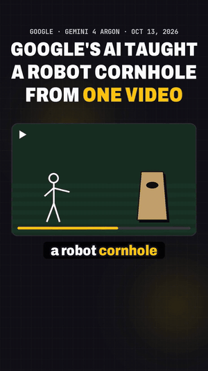
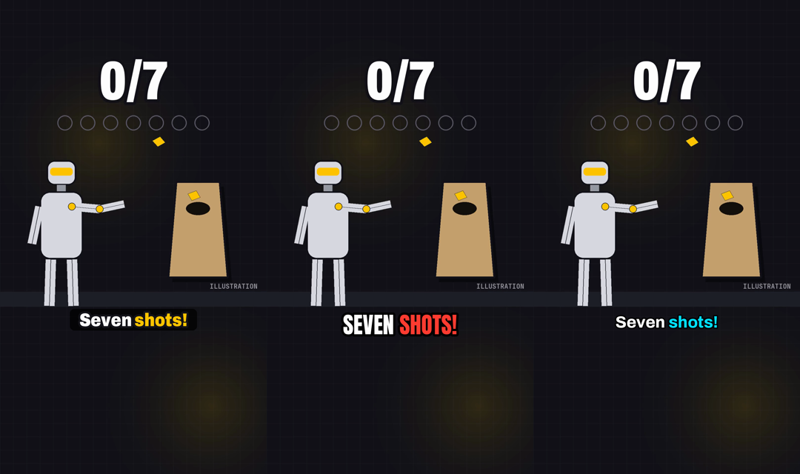
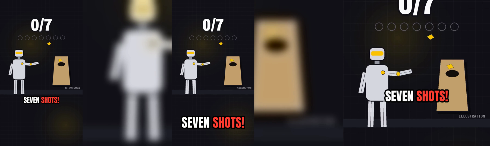

# karaoke-captions

**Word-by-word karaoke captions for Shorts, Reels and TikToks. One command, offline, no API key.**

```
karaoke clip.mp4            # -> clip_captioned.mp4
```

<p align="center"></p>

For people who make short videos and are tired of captions that light up before or after the word. One speech model,
NVIDIA Parakeet, writes the text *and* times every word in the same pass, on your own machine. A second tool lets an AI
coding agent (Claude Code, Codex) double-check the words with Whisper before anything is burned in.

## Why another caption tool

Most auto-caption tools are built on Whisper. Whisper is great at the words, but its word timestamps are guesses spread
across a sentence. We measured 89 of our own Shorts (9,020 words): every word ended exactly where the next one began,
and after a pause the median word start was ~195 ms off. You notice anything over ~50 ms.

[NVIDIA Parakeet-TDT](https://huggingface.co/nvidia/parakeet-tdt-0.6b-v3) predicts each word together with its
duration. On test sentences with exactly known word boundaries the median error was 34–60 ms. After a pause, `karaoke`
also moves any word that starts in silence onto the voice, and `karaoke check` refuses to burn captions whose timing
fails.

## Install

You need **Python 3.11+** and **ffmpeg** (`brew install ffmpeg`, `sudo apt install ffmpeg` or `winget install ffmpeg`).

```
pip install "git+https://github.com/PeerReviewedShorts/karaoke-captions"
```

Prefer an isolated install for command line tools: `pipx install "git+https://github.com/PeerReviewedShorts/karaoke-captions"` or
`uv tool install "git+https://github.com/PeerReviewedShorts/karaoke-captions"`. There is no PyPI package; GitHub is the only source.

The first run downloads the Parakeet model from Hugging Face (about 2.5 GB, once). It handles 25 European languages
and needs no account or key.

On Linux without an NVIDIA GPU, install the CPU build of PyTorch first; it saves about 2 GB of CUDA libraries:
`pip install torch --index-url https://download.pytorch.org/whl/cpu`.

**Update:** `pip install -U "git+https://github.com/PeerReviewedShorts/karaoke-captions"` (or `pipx upgrade karaoke-captions`). Your words files, presets and `karaoke.toml` stay as they are.
**Uninstall:** `pip uninstall karaoke-captions`. To free the disk space too, remove the model:
`hf cache rm model/nvidia/parakeet-tdt-0.6b-v3` (or delete `~/.cache/huggingface/hub/models--nvidia--parakeet-tdt-0.6b-v3`).

## Two tools

| | `karaoke` | `karaoke-agent` |
|---|---|---|
| For | anyone with a terminal | AI coding agents (Claude Code, Codex), or people who want a second check |
| Speech model | Parakeet: text + timing in one pass | Parakeet for the timing, **plus Whisper as a second opinion** |
| Extra checks | timing checks, a plain-text review file | words where the two models disagree, glossary near-misses, accept/reject log |
| Needs | Python, ffmpeg | the same, plus one Whisper backend the agent picks for your machine |

### Tool 1: `karaoke` (no AI agent)

```
karaoke clip.mp4                                  # transcribe, check, render, burn
karaoke clip.mp4 --preset bold                    # amber (default) | bold | clean, or your own .json
karaoke fix clip.mp4 "Aptronics|Apptronik's"      # fix words (any count); their time span stays
karaoke fix clip.mp4 --from-review                # or edit clip.review.txt and carry the edits over
karaoke preview clip.mp4 --at 4.2                 # one frame as PNG, to try a style in a second
karaoke render clip.mp4 && karaoke burn clip.mp4  # re-render after a fix (reuses the words)
karaoke check clip.mp4                            # exit 2 if a timing check fails
```

### Tool 2: `karaoke-agent` (for an AI coding agent)

Run `karaoke-agent init` once in the folder with your clips. It writes the agent instructions there (`AGENTS.md`
for Codex and others, `CLAUDE.md` and a skill for Claude Code; existing files are left alone). Then open the folder in your agent and say *"put karaoke captions on
clip.mp4"*. The agent follows [the guide](karaoke_agent/guide.md):

```
karaoke-agent sysinfo                                     # OS, chip, RAM, GPU, installed Whisper backends
karaoke-agent setup --backend whisper.cpp --model large-v3-turbo --reason "Apple M1, 16 GB, Metal"
karaoke-agent run clip.mp4 --glossary glossary.txt        # -> open suggestions (exit 3)
karaoke-agent decide clip.mp4 --accept 1,2 --edit "2=Apptronik's"
karaoke run clip.mp4                                      # render + burn with the corrected words
```

The agent picks the Whisper backend that fits your machine (whisper.cpp, mlx-whisper, faster-whisper or
openai-whisper, plus a model size) and writes the choice and the reason into `karaoke.toml`. It asks before it
installs or downloads anything.

On the demo clip both kinds of error showed up:

- **The models disagreed.** Parakeet heard "map", Whisper heard "mapped". That gets flagged.
- **Both models agreed on the same wrong word:** "Aptronics" instead of "Apptronik's". Comparing transcripts can't
  catch that; the glossary ([example](examples/glossary.txt)) does.

Runs without an agent (cron, CI) can add `--llm`, an LLM proofreader that only returns suggestions. It needs
`pip install "karaoke-captions[llm] @ git+https://github.com/PeerReviewedShorts/karaoke-captions"` and Anthropic credentials. *Experimental: not yet tested against the live API.*

## Styles: fonts, colors, size, position

<p align="center"></p>

Every style option works on `run`, `render` and `preview`:

```
karaoke clip.mp4 --font "Arial Black" --accent "#00FF88" --plate none
karaoke clip.mp4 --font ~/fonts/MyFont.otf --size 90 --uppercase --color white --outline black --outline-width 6
karaoke clip.mp4 --plate "#000000B0" --y 0.8 --max-words 2
```

- **Fonts:** a `.ttf`/`.otf`/`.ttc` path, a bundled font (`Anton`, `Archivo`) or the name of an installed font
  (`"Arial Black"`, `Georgia`, `DejaVuSans-Bold`). Variable fonts take axes: `"axes": {"wght": 900, "wdth": 85}`.
- **Other alphabets:** if the font lacks characters of your transcript (the bundled fonts are Latin only), `karaoke`
  switches to an installed font that has them and tells you; pick your own with `--font`.
- **Colors:** `#RRGGBB`, `#RRGGBBAA` (with alpha), `255,196,0` or a name like `white`.
- **Size and position** are given for a 1080 px wide short and scale with the video. `--y` is the bottom edge of the
  captions, as a fraction of the height (`0.72`) or in pixels.
- A word wider than the frame shrinks to fit instead of running off the edge.
- **Your own preset:** `karaoke presets --show bold > mine.json`, edit it, use `--preset mine.json`. Keys you leave
  out fall back to the defaults; see [examples/my-style.json](examples/my-style.json).

## Any video

<p align="center"></p>

- **Any frame size:** 9:16, 16:9, 1:1, 4K. The overlay is only as tall as the captions: a 4K 60 fps clip renders
  in about the time a 1080p one does.
- **Phone videos with a rotation flag** come out upright, **non-square pixels** (anamorphic) come out undistorted, and
  **odd sizes** (721×1281) are padded to even for H.264.
- **Any container:** mp4, mov, mkv, webm. Audio that cannot go into an .mp4 as is (PCM, Opus, Vorbis) is converted to
  AAC; AAC and MP3 are copied untouched.
- **HDR** (iPhone HLG, HDR10) stays HDR (HEVC 10-bit) when your ffmpeg has libx265, otherwise you get a warning.
- `--full-frame` writes a frame-sized transparent overlay (`clip.captions.mov`, QuickTime Animation with alpha) for
  your video editor instead of burning it in.

## Hardware

`--device auto` (the default) uses an NVIDIA GPU (CUDA), else Apple Silicon (MPS), else the CPU. If the GPU fails, for
example out of memory, it falls back to the CPU and says so.

| Machine | Status | Measured (27-s clip) |
|---|---|---|
| Apple Silicon (M1, 16 GB) | tested: CPU and MPS give identical words and times | MPS 9–12 s, CPU 19 s (with model loading) |
| Linux / Windows, CPU | the CI workflow runs the unit and render tests there on every push (the speech model is not run in CI) | — |
| NVIDIA GPU (CUDA) | supported through PyTorch, **not yet tested by us** | — |
| Intel Mac | **not supported:** PyTorch 2.5+, which transformers 5 needs, has no Intel-Mac builds | — |

Parakeet needs about 3 GB of RAM on the CPU. Long audio is decoded in 2-minute windows, so a podcast does not need
more.

## Files

Everything lands next to the clip as plain text or JSON, so you (or an agent) can open it:

| File | What |
|---|---|
| `clip.words.json` | every word with start and end time: the source of truth |
| `clip.review.txt` | the text to read and correct |
| `clip.srt` | captions for platforms that take a file |
| `clip.check.json` | timing check result |
| `clip.captions.mov` | the transparent overlay |
| `clip_captioned.mp4` | the result |

`karaoke-agent` adds `clip.whisper.json`, `clip.disagree.json`, `clip.suggestions.json` and `karaoke.toml`. The
original clip is never overwritten. Every command takes `--json`; exit codes: 0 ok, 1 error, 2 timing check failed,
3 suggestions waiting.

## Troubleshooting

| Message | Fix |
|---|---|
| `ffmpeg not found on PATH` | install ffmpeg (see Install) and open a new terminal |
| `font 'X' not found` | give the full path to the .ttf/.otf, or the exact file name of an installed font |
| `font … has no glyph for …` | your language needs other characters; pass a font that has them with `--font` |
| `a timing check failed` (exit 2) | read `clip.check.json`; music under speech or a wrong clip are the usual causes. `--force` renders anyway |
| `has no video stream` | audio only: `karaoke transcribe` still writes the words and an `.srt` |
| `the overlay was rendered for another frame size` | run `karaoke render` again for this clip |

## Models and licenses

- **Code:** MIT, see [LICENSE](LICENSE).
- **Parakeet-TDT 0.6B v3:** © NVIDIA, CC BY 4.0, downloaded from Hugging Face on first use. Every words file records the
  model in its `provenance` block.
- **Whisper:** MIT, only used by `karaoke-agent`, through the backend you install.
- **Fonts:** Archivo and Anton, SIL Open Font License; the license texts are in `karaoke/fonts/`.
- **ffmpeg** is not bundled.

## Contributing and security

Bug reports and pull requests are welcome, see [CONTRIBUTING.md](CONTRIBUTING.md). Security issues:
[SECURITY.md](SECURITY.md). Changes: [CHANGELOG.md](CHANGELOG.md).
